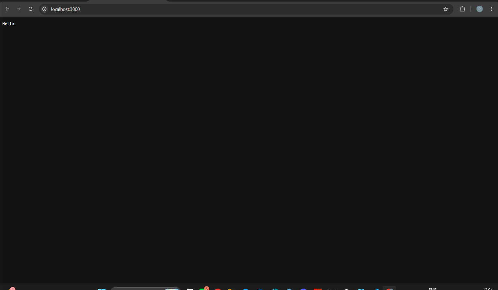
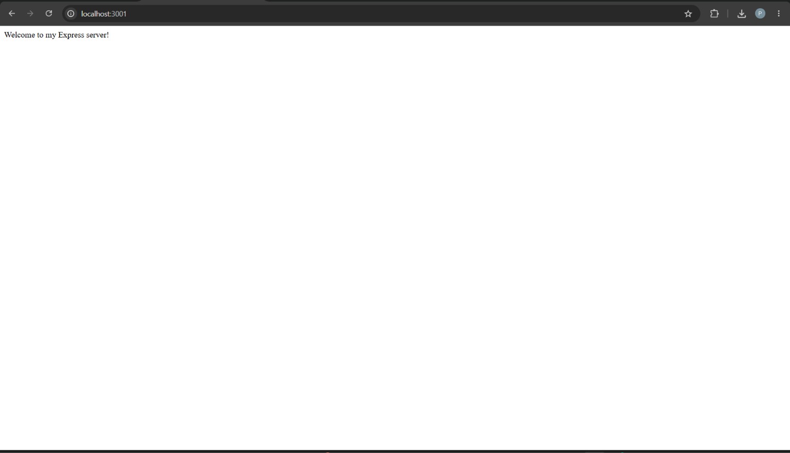
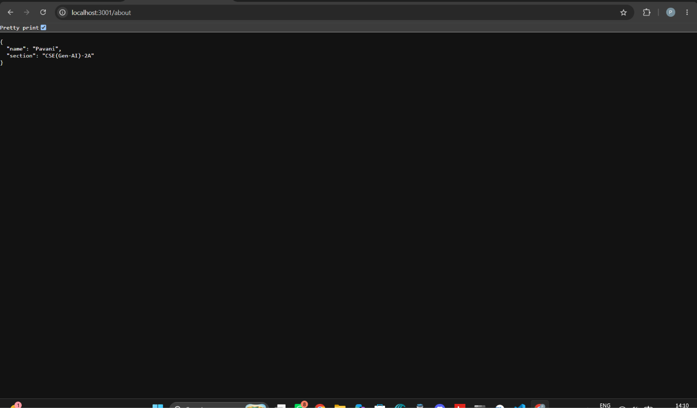
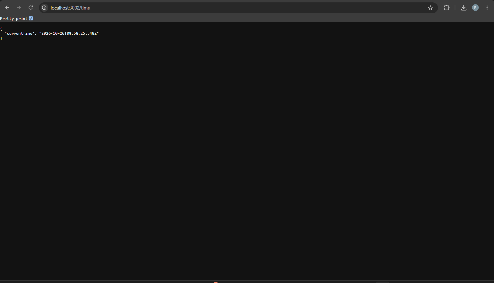
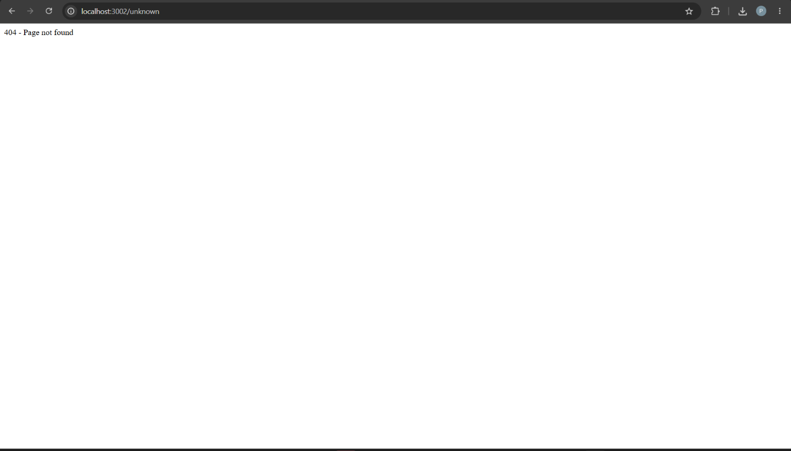

# Lab 1: Node.js and Express Server

## Student Details
- **Name:** Pavani
- **Section:** GenAI 2A
- **Subject:** Backend Development Fundamentals

## Aim
To create a web server using Node.js and Express.js and handle different HTTP requests through routes.

## Technologies Used
- Node.js
- Express.js
- JavaScript
- HTML
- GitHub
- Render

## Project Description
This project demonstrates how to create a web server using Node.js and Express.js. It contains different routes, including a home page, an about page, a current-time route, and a route for handling unknown requests.

## Project Structure

```text
Lab-01/
├── screenshots/
│   ├── about.png
│   ├── home.png
│   ├── server-hello.png
│   ├── time.png
│   └── unknown.png
├── README.md
├── app.js
├── package-lock.json
├── package.json
└── server.js
```

## How to Run the Project Locally

1. Install Node.js on your computer.
2. Download this repository and open the `Lab-01` folder in your terminal.
3. Install the required dependencies:

   ```bash
   npm install
   ```

4. Start the application:

   ```bash
   node app.js
   ```

5. Open the following address in your browser:

   `http://localhost:3000`

## Live Deployment

**Platform:** Render

**Live URL:** https://backend-development-fundamentals-1-da7b.onrender.com/
## Screenshots

### 1. Server Running


### 2. Home Page


### 3. About Page


### 4. Current Time


### 5. Unknown Route


## Result
Successfully created a Node.js and Express.js web server with multiple routes and organized the project files and screenshots.

## Problems Faced
During this lab, I faced some difficulties organizing the project files and displaying screenshots correctly in the GitHub README. I resolved these issues by arranging the files into folders and using relative paths for the screenshots.
