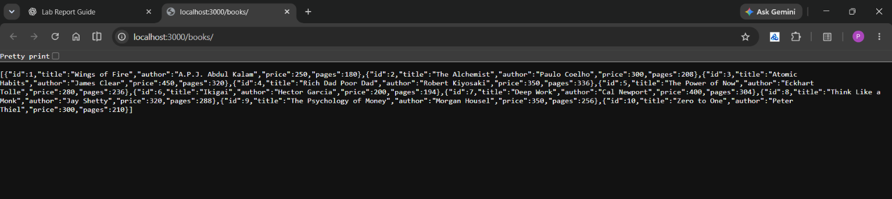
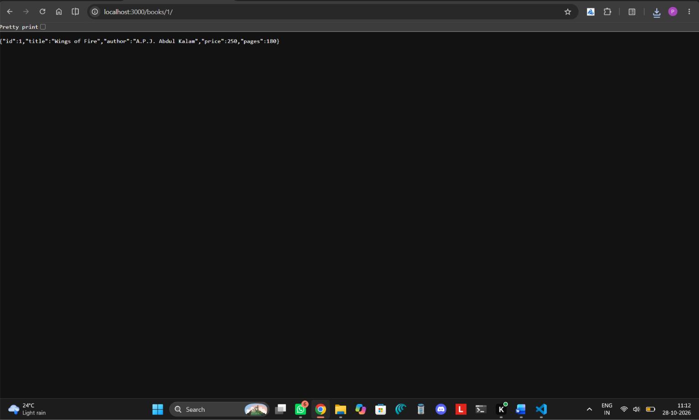
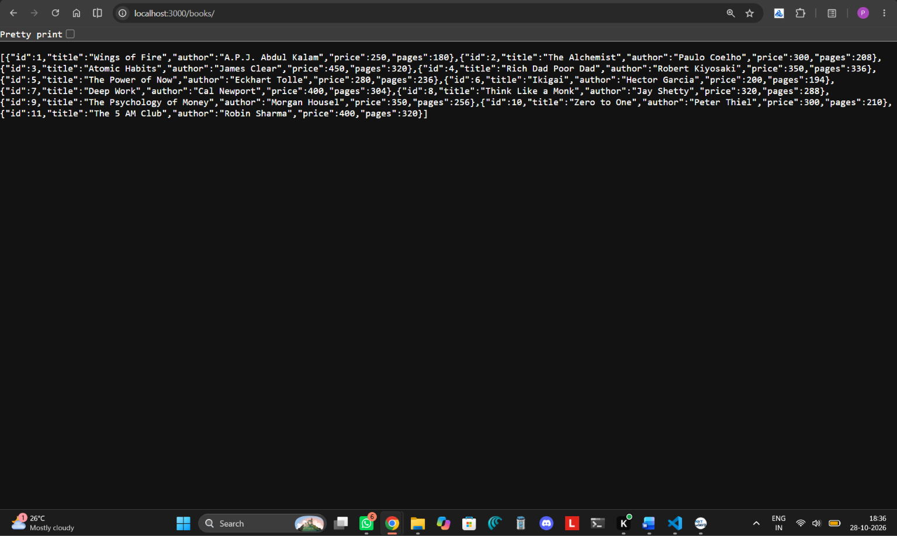
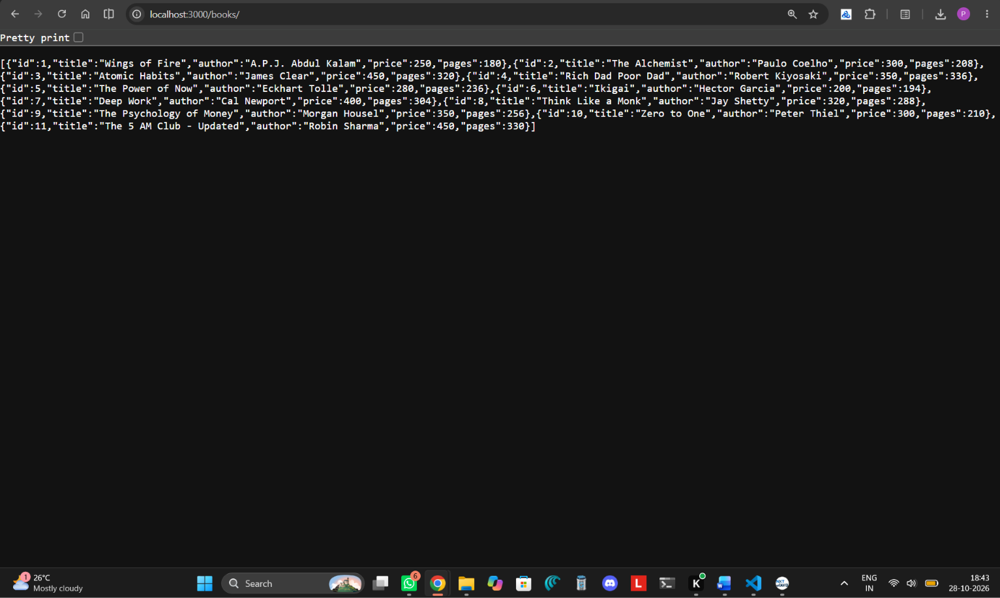
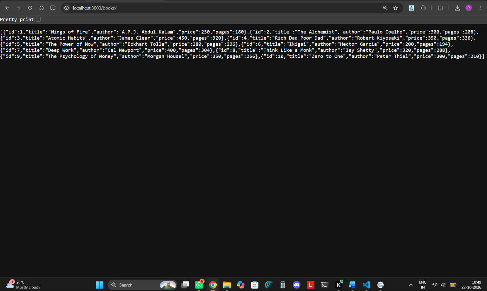
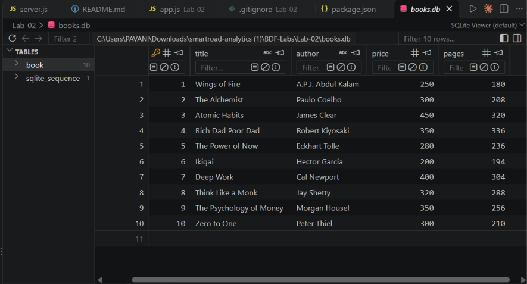

# Lab 2: SQLite Database and CRUD Routes

## Student Details
- **Name:** Pavani
- **Section:** GenAI 2A
- **Subject:** Backend Development Fundamentals

## Aim
To create a SQLite database and implement CRUD operations using Node.js and Express.js.

## Technologies Used
- Node.js
- Express.js
- SQLite
- JavaScript
## Live Deployment

**Deployed Application:** https://backend-development-fundamentals-1-da7b.onrender.com/

**Get All Books API:** https://backend-development-fundamentals-1-da7b.onrender.com/books/

**Get Book by ID:** https://backend-development-fundamentals-1-da7b.onrender.com/books/1/

## Project Description
This project demonstrates how to connect a SQLite database to a Node.js application and perform CRUD operations on book records. The API supports creating, retrieving, updating, and deleting books.

## How to Run
1. Open the `Lab-02` folder in the terminal.
2. Install dependencies using `npm install`.
3. Start the server using `npm start`.
4. Test the API using a browser or an API testing tool.

## Screenshots

### 1. Retrieve All Books

### 2. Retrieve a Single Book

### 3. Create a Book

### 4. Update a Book

### 5. Delete a Book

### 6. SQLite Database

## Result
Successfully created a SQLite database and implemented CRUD routes using Node.js and Express.js.
