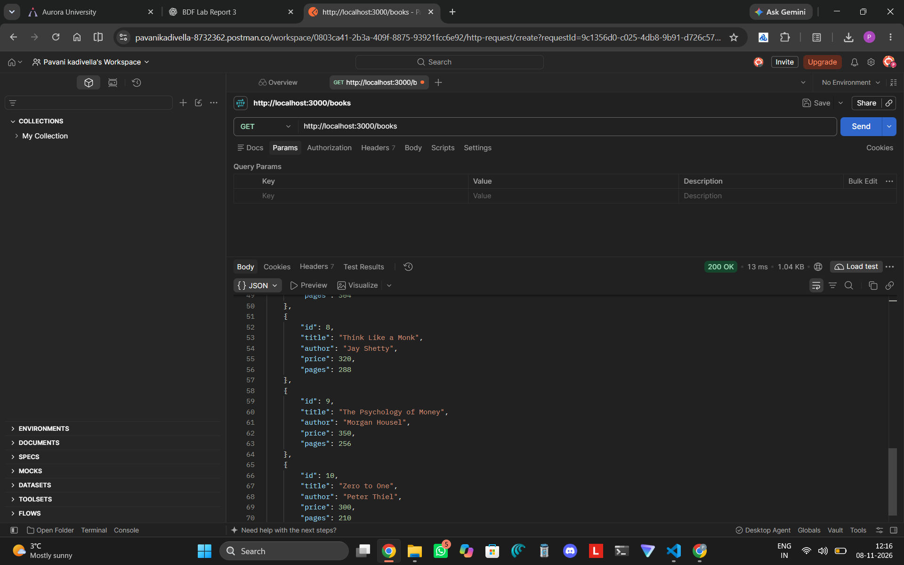
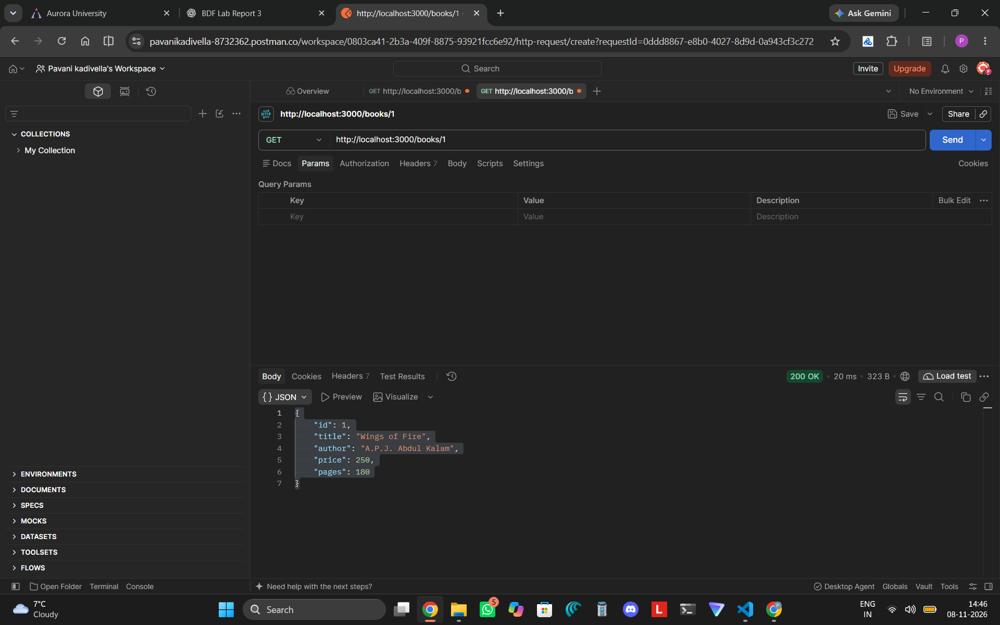
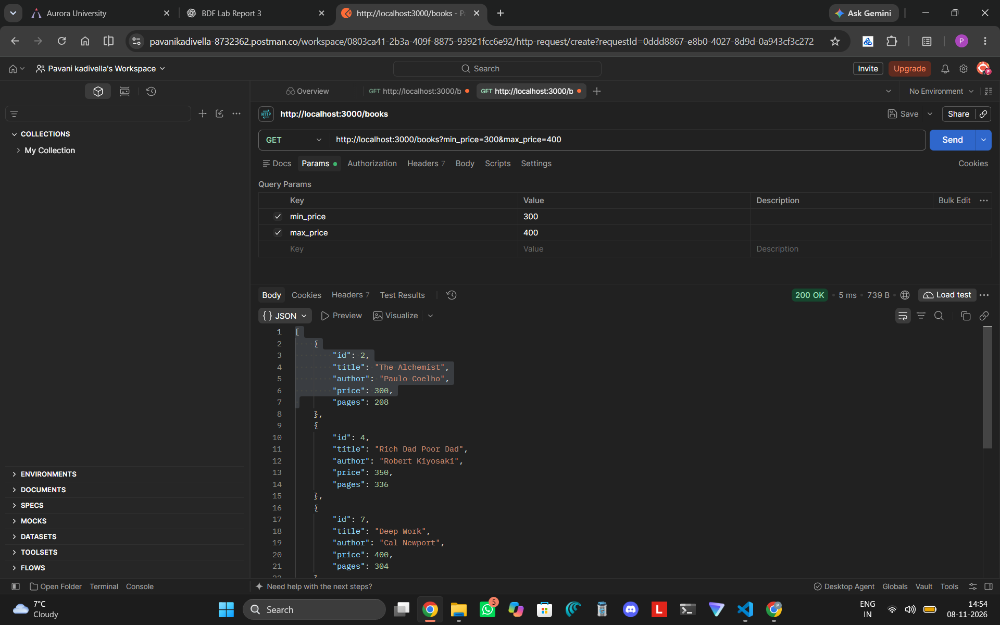
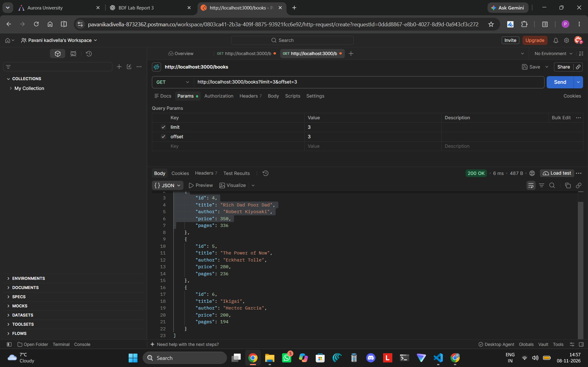
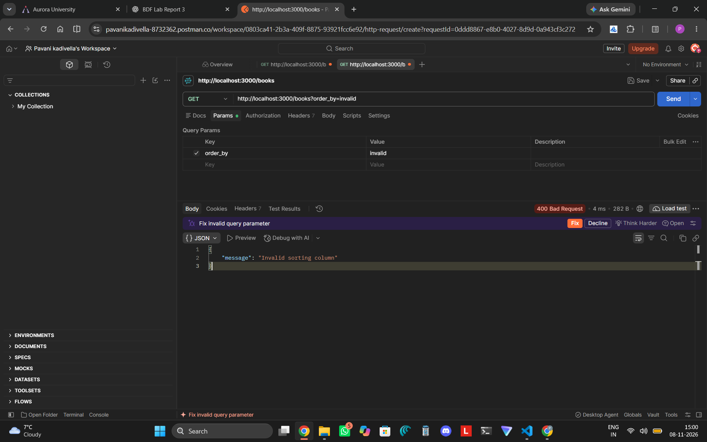
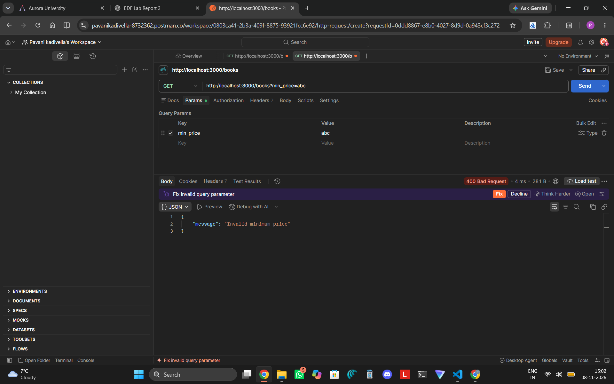
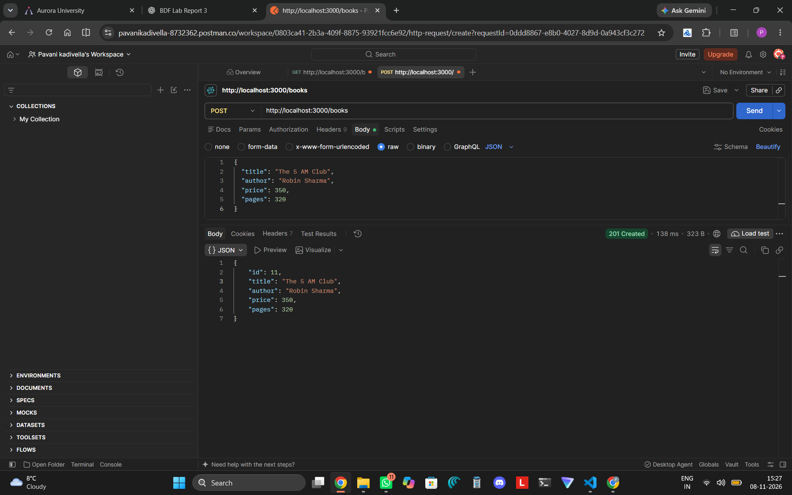
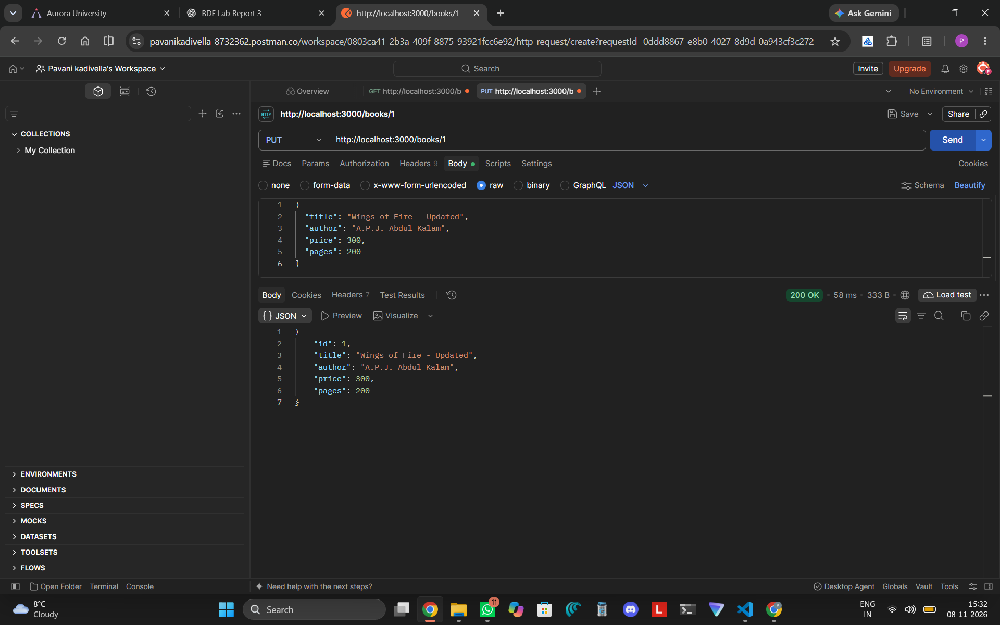
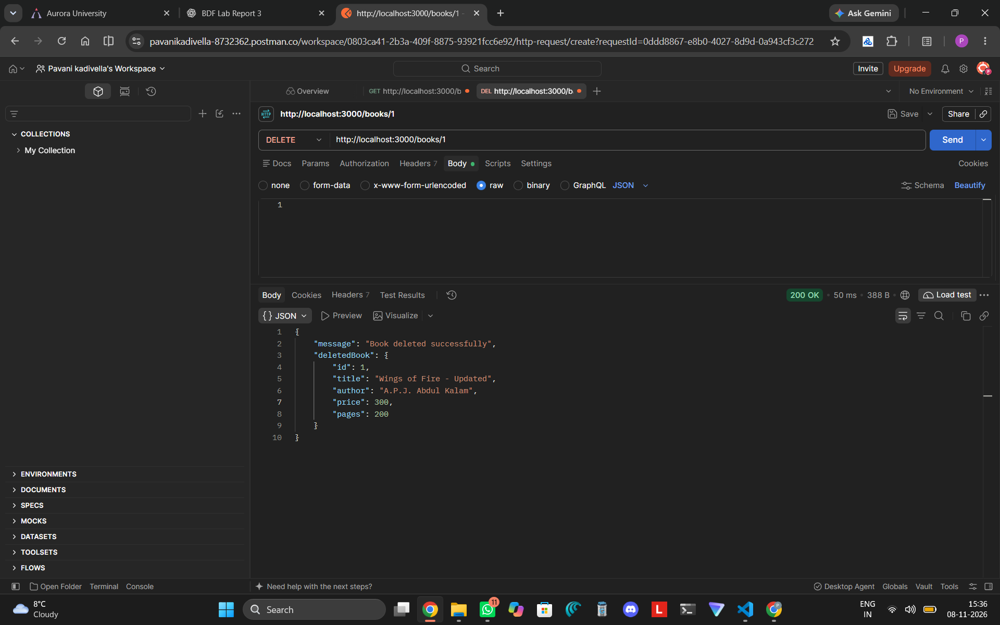
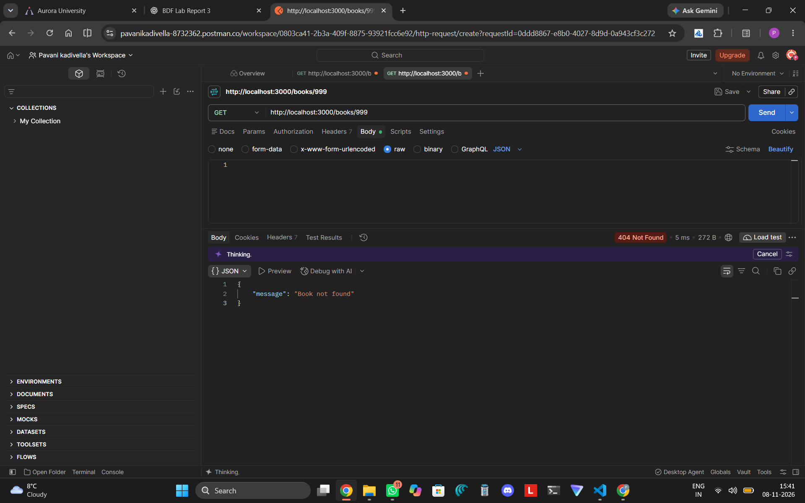

# Lab 03: REST API, Query Parameters, Validation and Debugging

**Name:** Pavani  
**Section:** CSE(Gen-AI)-2A  
**Registration Number:** 252U1R9051

## 1. Project Description

This project implements a REST API for managing books using Node.js, Express.js and SQLite.

It supports retrieving, searching, sorting, filtering, adding, updating and deleting books. It also includes input validation and appropriate HTTP status codes for handling errors.

## 2. Technologies Used

- Node.js
- Express.js
- SQLite
- Postman
- JavaScript

## 3. How to Run the Project

**Step 1: Install dependencies**

```bash
npm install
```

**Step 2: Start the server**

```bash
node app.js
```

**Step 3: Server URL**

`http://localhost:3000`

**Live URL:** Not deployed. The API was tested locally using Postman.

## 4. API Endpoints

| Method | Endpoint | Description |
|---|---|---|
| GET | `/books` | Retrieve all books |
| GET | `/books/:bookId` | Retrieve a book by ID |
| GET | `/books?search_q=the` | Search books by title |
| GET | `/books?order_by=price&order=DESC` | Sort books by price |
| GET | `/books?min_price=300&max_price=400` | Filter books by price |
| GET | `/books?limit=3&offset=0` | Paginate book results |
| POST | `/books` | Add a new book |
| PUT | `/books/:bookId` | Update a book |
| DELETE | `/books/:bookId` | Delete a book |

## 5. Validation and Error Handling

The API validates user inputs and returns suitable HTTP status codes.

- **200 OK:** Request completed successfully.
- **201 Created:** New book added successfully.
- **400 Bad Request:** Invalid input provided.
- **404 Not Found:** Requested book does not exist.
- **500 Internal Server Error:** Server-side error.

## 6. Screenshots

### GET All Books


### GET Single Book


### Search Books


### Sort Books


### Filter Books


### Pagination


### Invalid Sorting


### Invalid Price


### POST Book


### PUT Book


### DELETE Book


### Book Not Found


## 7. Conclusion

Through this lab, I learned how to build REST API endpoints using Express.js, work with SQLite databases, use query parameters for searching and filtering, implement validation, and handle errors using appropriate HTTP status codes. I tested the API using Postman.
